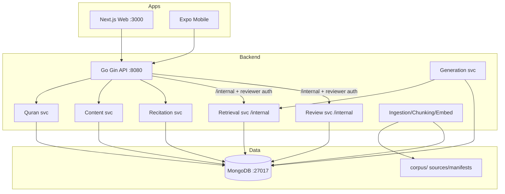

# Project Status and Plan for Tadbor

> **Current audit update — 2026-10-25:** This section supersedes any conflicting
> historical “current state” statements and proposed execution steps below.
> The detailed sections that follow retain the original project plan and are
> useful as design history, but they are not a substitute for the live audit in
> [`PROJECT_STATUS.md`](PROJECT_STATUS.md).

## Current Verified State

- Checkout at audit: branch `main`, HEAD and `origin/main` at
  `eeb9e0fa5b5b88a88a22817504065bd1c80f41fc`. The worktree contains local,
  uncommitted backend, web, test, and documentation changes; preserve them.
- Runtime architecture is Go/Gin + MongoDB, Next.js web, and Expo/React Native.
  Docker Compose provides MongoDB only. No production deployment was verified.
- Local checks for this audit: `cd backend && go test ./... -count=1`,
  `cd backend && go build ./...`, `cd web && npm run build`, and
  `git diff --check` passed. Direct `cd mobile && npx tsc --noEmit` failed at
  `mobile/App.tsx:9` because the installed React Native `StatusBar` type does
  not accept `backgroundColor`. CI masks the mobile typecheck failure with
  `|| true`.
- `MONGO_URI` and `MONGO_TEST_URI` were not configured. Mongo integration tests
  were skipped; current database contents, source flags, published records,
  recitations, indexes, and audit rows remain unverified.
- Source verification records conflict: `corpus/sources/ibn-kathir-ar.json`
  says `verified`, but `docs/reviews/ibn-kathir-ar-surah-12.md` describes an
  “automated-pilot” review, says printed-edition provenance cannot be repeated,
  and lists 19 entries requiring human review. Issue #30 is closed with a
  comment claiming verification. Do not use the JSON flag alone as proof; a
  qualified content owner must reconcile the evidence before trusting the
  source.
- The introduction API and Surah 12 generation pipeline are present in local
  changes. Generation defaults to preview and the `-live` path writes drafts
  as pending after provenance and structural validation. Semantic entailment
  is not automated: resolved citations do not prove that the cited text
  supports the claim.
- Introduction approval is deliberately **disabled**. The internal decision
  HTTP route returns `503`, and the dashboard has no approval controls, because
  the current login is a shared password plus caller-entered display name, not
  a trusted identity or reviewer qualification. A trusted identity provider
  and explicit reviewer authorization mapping are prerequisites to enabling
  approval. The direct service method and its Mongo tests do not make approval
  reachable through the registered HTTP workflow.
- Web contains an API-backed Surah reader but no verified library/discovery
  route or public introduction view. It requests `simplified_ar` only. Mobile
  mounts Surah 12 only; several controls are presentation-only, its style IDs
  differ from backend IDs, and playback has not been device-tested.
- Audio URLs and player code exist; EveryAyah licensing remains unresolved.
  There is no offline/download implementation. No live URL checks or playback
  tests were run during this audit.
- GitHub search found issues #1–30, with supplemental exact-title lookups for
  #31–43. At audit time #1–14 and #24–43 were CLOSED; #15–23 were OPEN. Closure
  comments conflict with current documented evidence for #30, #39, #35, and
  #43; issue state is not verification of acceptance criteria. See
  [`PROJECT_STATUS.md`](PROJECT_STATUS.md) for the complete issue snapshot and
  acceptance comparison.

## Current Recommended Plan

Order work by safety dependencies. Do not run production generation or publish
content as part of this plan unless the required human decisions and safe target
database are explicitly established.

1. **Reconcile source approval (P0).** Assign a qualified content reviewer,
   resolve the 19 review-sheet entries, document reproducible printed-edition
   provenance or replace the source, and only then reconcile the registry
   verification field. Keep generation blocked if this remains unresolved.
2. **Configure trusted reviewer identity and authorization (P0).** Select an
   identity provider, map verified identities to reviewer qualifications,
   derive audit identity server-side, and enforce the checklist and source
   validation at the API boundary. Keep introduction decisions at 503 until
   this is implemented and tested. The shared password/free-text label is not
   an acceptable reviewer identity.
3. **Verify data in an isolated MongoDB (P0).** Configure an explicitly
   disposable `MONGO_TEST_URI`; run introduction API, draft persistence,
   source downgrade/version-change, and review transition integration tests.
   Separately establish the current database’s content and audit state through
   an authorized, non-production procedure.
4. **Reconcile published explanations (P0).** Issue #39’s closure note says
   111 per style were published but also reports review records missing. Audit
   every published record against its review record, cited chunks, current
   source version, and qualification policy before declaring content reviewed.
5. **Complete public reading contracts (P1).** Implement/test `GET /surahs`,
   introduction reader UI, style registry/availability and per-content
   readiness; keep exact-style behavior and never substitute another style.
   Validate OpenAPI and fixtures in CI.
6. **Fix and test mobile parity (P1).** Fix the `StatusBar` typecheck, remove
   the `|| true` CI suppression, align style identifiers with the backend,
   make visible controls functional or remove them, and exercise audio on a
   device/simulator.
7. **Complete quality and launch readiness (P1/P2).** Make API failures
   visible instead of treating them as empty data, add browser/device and
   accessibility checks, resolve audio rights, refresh stale docs, and only
   then execute deployment/backup/rollback and release QA issues #15–16.

**Verification boundary:** passing Go tests/builds and a web build confirms
code-level checks only. It does not establish that Mongo contains valid content,
that live generation works, that generated claims are semantically supported,
that a qualified human approved them, or that the UI works against a real
service. Mongo tests skip without `MONGO_TEST_URI`; no database or external
generation/audio command was run in the audit.

## 1) Executive Summary

Tadbor is a Quran understanding application intended to present reader-facing Quranic text with RAG-grounded, human-reviewed explanations. The repository is a multi-app scaffold (Go backend, Next.js web reader/admin, Expo/React Native mobile) with MongoDB for storage and a deliberate pipeline of ingestion → retrieval → generation → mandatory human review before publication.

**Current state (verified):**
- Core skeleton is present and wired: API routes for Quran, recitations, explanations, internal retrieval/review gated by shared reviewer password; web reader fetches from API and displays Uthmani text + audio + published explanations; admin dashboard exists with checklist-based review flow.
- Surah Yusuf (12) corpus is real (Uthmani text seeded from verified corpus). Recitations are loaded/checked for Surah 12 (444 files across 4 reciters) with gate logic.
- RAG/ingestion pipeline tooling is extensive (source registry, chunking, mapping, embedding, coverage checks, validation). Ibn Kathir Arabic for Surah 12 is committed but registered as `verification_status: unverified` with explicit human review required; retrieval is configured to only use `source_verified: true` chunks. As a result, generation cannot produce content into the real DB currently (guardrail working).
- Generation is implemented with strict contract (structured JSON schema, deterministic validation, citation resolution, requires_review enforced, per-task prompt guidance). Reviewer flow records audit entries and enforces pending→published/rejected/escalate with conditional updates.
- Auth is a shared secret header for `/internal` (fails closed when unset). No per-reviewer identity/expiry/revocation.

**Major gaps/blockers (verified):**
- Ibn Kathir source is unverified → retrieval returns nothing for real DB → `make generate` reports insufficient evidence / cannot write; batch generation exists but cannot publish to real DB.
- No published explanations exist yet for readers (content service filters `review_status: "published"` only; queue empty until generation writes pending).
- Vector storage is brute-force cosine in Go (no Atlas Vector Search / no DB-native vector index). Embedding provider optional.
- Tafsir ingestion pipeline is written/verified against throwaway DB, but real DB not populated from verified sources.
- Mobile app exists but not containerized (intentional). Some setup details need LAN/IP/tunnel configuration.

## 2) Project Purpose and Scope

**Purpose (from README/docs):** Quran understanding app with RAG-grounded explanations, mandatory human review before publication. 
- Reader sees Quran text + per-ayah recitation + published explanations only.
- Explanations must be grounded in approved tafsir sources with citations.
- Review gate enforced (shared reviewer password) with audit trail.

**Scope in repo:** Modular monolith backend (Go/Gin), web (Next.js 14), mobile (Expo), MongoDB, offline batch jobs (seeding, ingestion, embedding, generation), corpus/manifests/docs, docker-compose for Mongo only.

**Out of scope/not present:** Per-reviewer accounts/roles beyond shared secret, multi-tenant auth for readers, automated religious correctness judgment (only technical safeguards), calendar dates/promises.

## 3) Repository Overview

**Top-level layout (verified):**
```
tadbor/
├── backend/        # Go modular monolith
├── web/             # Next.js reader + admin
├── mobile/          # React Native / Expo
├── scripts/         # one-off jobs
├── docs/            # architecture, guides, reviews
├── corpus/          # sources, tafsir, manifests
├── docker-compose.yml
├── Makefile
├── .env.example
└── README.md
```

**Git:** branch `main`, up to date with origin/main. Recent commits focus on batch generation, recitations, dialect/translate support, validation fixes. Working tree has uncommitted changes to `mobile/package.json` and `mobile/package-lock.json` (not modified by this audit).

**Docs present:** master-outline, rag-architecture-part1/part2, build-deploy-guide, ADDENDUM-mongodb-pivot (notes Postgres→MongoDB), quran-corpus-validation, tafsir-chunk-mapping, tafsir-embeddings, tafsir-source-registry, recitation-audio-sources, batch-generation, reviewer-dashboard, local-stack-verification, reviews/ibn-kathir-ar-surah-12.md.

**Multiple apps:** web (Next.js), backend (Go), mobile (Expo) — confirmed.

## 4) Current Technology Stack

| Component | Tech | Version/Notes (evidence) |
|---|---|---|
| Backend | Go | go 1.22 (go.mod). Gin v1.10.0, mongo-driver v1.16.0, godotenv v1.5.1 |
| Web | Next.js + React + TS | Next 14.2.35, React 18.3.1, TypeScript 5.9.3 (web/package.json) |
| Mobile | React Native + Expo | package.json in mobile/ (present). Not containerized. |
| Database | MongoDB | mongo:7 via docker-compose, collections: ayahs, surahs, reciters, recitations, explanations, reviews, tafsir_chunks, sources (implied by code) |
| Embeddings | HTTP provider (configurable) | EMBEDDING_API_URL points to HF router by default in .env.example; client in backend/internal/embedding |
| LLM | Gemini via HTTP (wired) | LLM_API_URL checked for geminiHost; schema-enforced structured output |
| Infra | Docker Compose (Mongo only), Makefile, shell scripts | See Makefile targets |

**Note:** Docs say Postgres+pgvector originally; repo uses MongoDB (ADDENDUM confirms). Vector search is brute-force in Go (no Atlas Vector Search dependency).

## 5) System Architecture

### High-level (evidence-based)



**Key points:**
- Public routes: `GET /health`, `/surahs/:id/ayahs`, `/surahs/:id/explanations?style=...`, `/reciters`, `/surahs/:id/recitations?reciter=...` (see handlers).
- Internal routes under `/internal` gated by `ReviewerAuthMiddleware` requiring `REVIEWER_PASSWORD` header `X-Reviewer-Password`; fails closed if unset (503).
- Content service filters `explanations` where `review_status == "published"` only (hard filter). Review_status/source_version_snapshot hidden from public API.
- MongoDB connection via `platform.NewMongoConnection()` using `MONGO_URI`.

**Uncertain:** Exact production deployment topology (not verifiable from repo). Mobile networking depends on env/LAN/tunnel.

## 6) Feature Inventory and Implementation Status

| Feature | Intended | Status | Evidence | Notes |
|---|---|---|---|---|
| Quran browsing (Surah/ayah) | View Uthmani text per surah | **Implemented (verified)** | `web/app/surah/[id]/page.tsx`, `backend/internal/quran/*`, seeded Surah 12 | Surah 12 present; general pagination/surah list UI not obvious from inspected files (page fetches by id). |
| Per-ayah recitation audio | Play recitations per ayah, switch reciter | **Implemented (verified)** | `web/app/surah/[id]/page.tsx`, `backend/internal/recitation/*`, `Makefile` audio/audio-check | 4 reciters loaded; audio checked for Surah 12 (444 entries). Public hotlinking rights unresolved per docs. |
| Explanations display | Show published simplified Arabic explanations | **Implemented (verified) but empty in DB now** | `web/app/surah/[id]/page.tsx`, `backend/internal/content/*` | Filters to published only; none exist yet. |
| Arabic/English support (styles) | Styles `simplified_ar`, `egyptian_ar`, `en` | **Partially implemented** | generation validation/gemini, content API takes style param | Web currently requests `simplified_ar` only; support exists in schema/validation. |
| Authentication (users/readers) | Reader auth? | **Not implemented** | No user auth routes found | Only reviewer auth for internal. |
| Bookmarks/reading progress/saved | — | **Not implemented / Unknown** | Not found in inspected files | No evidence. |
| Search | — | **Not implemented / Unknown** | Not found | No evidence. |
| Reviewer dashboard | Queue, checklist, approve/edit/reject/escalate, audit | **Implemented (verified)** | `web/app/admin/*`, `backend/internal/review/*` | Shared secret auth, checklist required in UI, blocks on missing evidence/stale grounding, records reviews. |
| Admin/data management | General admin beyond review | **Not implemented / Unknown** | Only `/admin` reviewer dashboard | No evidence of broader admin. |
| API integrations | LLM/embedding HTTP clients | **Implemented (verified)** | `backend/internal/generation/*`, `backend/internal/embedding/*` | Configurable via env; Gemini wired. |

## 7) Backend and API Assessment

**Routes (verified):**
- `GET /health` (public)
- `GET /surahs/:surahId/ayahs` (public, quran service)
- `GET /surahs/:surahId/explanations?style=` (public, content service - published only)
- `GET /reciters`, `GET /surahs/:surahId/recitations?reciter=` (public, recitation)
- `/internal/*` with `ReviewerAuthMiddleware` (reviewer auth): `GET /internal/review/queue`, `POST /internal/review/:explanationId/decision` (review), and retrieval routes mounted there per API wiring (`retrieval.RegisterRoutes(internal, ...)`) — retrieval service exists for evidence generation.

**Auth middleware:** Constant-time compare of header `X-Reviewer-Password` against `REVIEWER_PASSWORD`; if unset returns 503 "not set: /internal is disabled, not open". Shared secret only (no identity/expiry/revocation) — documented as acceptable for single reviewer now.

**Error handling:** Generally returns JSON errors; content/review map specific errors (e.g. review maps ErrNotPending to 409, ErrBadDecision to 400). Input validation present.

**Observability/logging:** Gin default middleware; basic logs. No explicit tracing/metrics evident from inspected files.

## 8) Database and Data Model Assessment

**DB:** MongoDB (7). Collections referenced in code: `ayahs`, `surahs`, `explanations`, `reviews`, `tafsir_chunks`, `sources`, `reciters`, `recitations`. No SQL migrations visible; seeding/ingestion via Go commands/scripts.

**Key models (evidence):**
- `quran.Ayah`: surah_id, ayah_number, text_uthmani, text_simple, corpus_version, content_hash
- `content.Explanation`: surah_id, ayah_start/end, style, level, text, source_refs, `review_status` (hidden), `source_version_snapshot` (hidden)
- `review.QueueItem`: includes evidence chunks, citations, missing_refs, grounding_version_mismatch, ayah_text, model/prompt versions
- `review.ReviewRecord`: explanation_id, reviewer_id, decision, comments, created_at, source_version, prompt_version, model_version
- `retrieval.TafsirChunk`: source_id, source_verified, text, embedding (float64), surah_id/ayah range, mapping_type, content_hash etc. (fields inferred from usage)
- `recitation.Reciter/Recitation`: present in API types

**Indexes/constraints:** Not explicitly visible in inspected code; MongoDB has no enforced FK constraints (relationships denormalized as noted in ADDENDUM). 

**Data access:** Direct mongo-driver queries. Vector search is brute-force cosine in Go over filtered chunks (self-hosted MongoDB has no built-in ANN in this setup).

## 9) Quran and Tafsir Data Pipeline

**Quran corpus:**
- Seeded via `backend/cmd/seed_quran` for Surah 12 (Uthmani). `make seed-check` re-verifies against quran.com + cross-checks. All 111 ayahs of Surah 12 are real Uthmani text (verified). 
- `corpus/` exists; quran corpus files referenced by seeding/validation.

**Tafsir data:**
- Committed: `corpus/tafsir/ar-tafsir-ibn-kathir-surah-12.md`, `corpus/sources/ibn-kathir-ar.json`, manifests in `corpus/manifests/`. 
- Source registry entry: `ibn-kathir-ar`, authority_tier 1, licensing_status `cleared` (public domain basis noted), but `verification_status: "unverified"`, `ingestion_status: "not_started"`. Digitisation noted as third-party quran.com API response (not a scan of specific printed edition). 
- Verification sheet `docs/reviews/ibn-kathir-ar-surah-12.md` lists 19 entries needing human review; machine checks pass (hashes/manifests/coverage) but fidelity/attribution to specific printed edition not fully established. 
- Tools exist: `fetch_tafsir`, `build_manifest`, `check_coverage`, `register_source`, `ingest`, `embed_chunks`, `tafsir_digest`. Docs describe chunk mapping/embeddings.

**Coverage/quality:** `make seed-check` and coverage checks exist. Duplication/missing content tracked via checks; exact DB state not inspectable without running Mongo.

## 10) RAG and AI Generation Pipeline

### Retrieval
- Service: `backend/internal/retrieval/service.go`. Strategy: exact ayah mapping first (`source_verified: true`, ayah range overlap) → if none, semantic fallback with thematic chunks only if embedder configured and query embedding available.
- Brute-force cosine similarity in Go over candidates (no Atlas Vector Search). `thematicTopK=5`. 
- If no embedder or empty embedding and no exact match → returns `ErrInsufficientEvidence` (hard stop). Provider failure during embedding is returned as error (not conflated with insufficient evidence).
- Only chunks from verified sources used. Mapping types include `single_ayah`, `multi_ayah`, `surah_level`, `thematic`.

### Generation
- Contract: `GenerationOutput` with content, source_refs, claims, warnings, confidence, `requires_review` always true (enforced). 
- Provider: Gemini only (host check). Structured output via JSON schema; system prompt restricts to evidence only, forbids invention, requires citation mapping.
- Task briefs: `simplify` (beginner, plain Arabic, no narration chains/technical details, no prescriptive should/must), `translate` (preserve), `adapt-dialect`/`adapt_dialect` (preserve certainty/negation/modality). 
- Deterministic validation (`generation/validation.go`): non-empty, <=2000 runes, claims require source_refs, requires_review true, script check per style (Arabic script for *_ar, Latin for en). Note dialect distinction not automated (human checklist). 
- Citation resolution: model gives positional numbers → resolved to chunk IDs; unresolved dropped with warnings.
- Retries: up to 3 with exponential backoff on 429/503; other errors fail fast.
- Versioning: `PromptVersion()` fingerprints system prompt+task briefs; `ModelVersion()` from URL.

### Current state
- Pipeline tools exist and tested logic present. `make generate` for Surah 12 written but **cannot write to real DB** because retrieval only returns verified-source chunks and Ibn Kathir is unverified → every ayah reports insufficient evidence (documented as guardrail working). 
- No published explanations exist.

## 11) Human Review and Religious-Content Safeguards

**Safeguards (evidence):**
- Public API serves only `review_status: "published"` (content service hard filter). 
- Review_status/source_version_snapshot never exposed to reader.
- Internal routes gated by shared reviewer password (fails closed). 
- Review flow requires checklist in UI (4 items) before approval; blocks UI actions conceptually if missing evidence/stale grounding.
- Review service: conditional update `explanations` with filter `{"_id": id, "review_status":"pending"}` only; inserts review record before update (audit-first). Prevents double-approval/race conditions. 
- Tracks `source_version_snapshot`, `prompt_version`, `model_version` on explanations/review records for traceability.
- Flags `grounding_version_mismatch` when snapshot differs from evidence chunk source version (blocks approval in UI).
- Flags missing refs (unresolvable citations) — blocks approval.
- `requires_review` always true in generation; escalation keeps status pending.
- Validation gates obvious failures before review.

**Gaps (verified):**
- Shared secret only (no per-reviewer identity/expiry/revocation) — documented.
- Human verification of Ibn Kathir fidelity/attribution to specific printed edition incomplete (19 items flagged). Source remains unverified.
- No automated theological correctness checking (by design). 
- No explicit content bypass path visible, but safeguards rely on pipeline discipline.

## 12) Frontend and Mobile Assessment

**Web (Next.js 14):**
- Reader: `/surah/[id]` fetches ayahs/explanations/reciters/recitations in parallel, maps explanations by ayah_start, shows Uthmani text (RTL), audio controls per ayah if present, explanation in styled box labeled "المعنى المبسط" when published. No client JS needed for reciter switcher (plain links). 
- Admin: `/admin` checks password state, fetches queue via server, shows checklist, evidence with citations/missing refs/mismatch warnings, approve/edit-approve/reject/escalate forms posting to `/admin/decision`. 
- API client has runtime type guards, degrades gracefully to empty lists.
- Config: API URL via env (fallbacks noted in docs). 

**Mobile (Expo):**
- Exists in `mobile/`. Not in docker-compose (intentional per README). Run via `npm start`/`make mobile`. Needs `EXPO_PUBLIC_API_URL` pointing to backend (localhost/emulator/LAN/tunnel). 
- package.json/lock modified in working tree (uncommitted). Details of screens/components not fully inspected in this pass but structure present.

**Issues/gaps:** Web only shows `simplified_ar`; no loading/error states elaborated beyond guards; mobile specifics need deeper inspection if required.

## 13) Authentication and Security Assessment

**Authentication:**
- Reviewer: shared secret via header `X-Reviewer-Password`, compared with `subtle.ConstantTimeCompare`. Fails closed if `REVIEWER_PASSWORD` unset. No sessions/cookies issued by API; web stores password in session mechanism (files in admin/ suggest session handling). 
- Readers: None.

**Security notes (verified):**
- Public explanations filtered to published only. 
- Internal routes isolated under `/internal` with middleware.
- No secret values in repo files inspected (env.example has placeholders). 
- Generation refuses to run without evidence; citation resolution prevents orphaned refs.
- Script validation and length limits. 
- Constant-time compare used.

**Concerns/gaps:**
- Shared secret is single point of failure, no rotation/revocation/identity/audit of who (only reviewer_id passed in request). 
- CORS not explicitly visible in inspected API setup (Gin default) — needs verification.
- Rate limiting not evident. 
- Input validation exists in places but comprehensive review not done.
- Secrets management relies on env files.

## 14) Testing and Code Quality

**Tests present (evidence):**
- Backend has many `*_test.go` files: api/platform/auth_test, content/quran/review/retrieval/generation/ingestion/embedding/textverify packages, cmd/* tests (seed_quran, generate_explanations, ingest_recitations, embed_chunks, build_manifest, check_coverage, fetch_tafsir, register_source, tafsir_digest, validate_retrieval). 
- Tests cover auth, validation, chunking, mappings, vectors, generation validation/retry/source_refs/gemini, review service, etc.

**Build/lint:** go.mod present, TypeScript in web, no obvious lint configs inspected. Makefile has build/test targets implied by commands.

**Code quality observations:**
- Well-documented with comments explaining design decisions (especially review/generation/retrieval). 
- Clear separation of concerns (services/handlers). 
- Defensive programming (guards, filters, conditional updates). 
- Some complexity in batch jobs/cmd tools.

**Checks executed in this audit (read-only):**
- `git log/status/branch` — done.
- Read README, Makefile, docker-compose, .env.example, backend API/main/auth/content/quran/review/retrieval/generation, web pages/api-client/admin, docs (ADDENDUM, ibn-kathir review), corpus sources.
- **No tests/builds executed** (to avoid modifying env/deps; environment not set up for full test run). Results: not run.

## 15) Local Development and Deployment

**Local dev:**
- Prereqs: Docker (for MongoDB), Go 1.22, Node/npm for web/mobile. 
- Setup: `cp .env.example .env` (fill keys as needed). 
- Start: `make dev` brings up MongoDB (docker) + Go API (:8080) + Next.js (:3000) in foreground. Only MongoDB containerized. 
- Seed: `make seed` loads Surah 12 Quran text and reciters; `make seed-check` verifies. 
- Audio: `make audio` fetches all recitations (444) takes ~2.5min; `make audio-check` gates. 
- Generate: `make generate` for all 111 ayahs (writes pending) but blocked on unverified source currently; `make generate-check` gates. 
- Mobile: `make mobile` runs Expo outside Docker.

**Deployment config:**
- `backend/Dockerfile` exists, `docker-compose.yml` only has Mongo. No k8s/terraform/cloud configs visible. Docs mention free-tier build/deploy phases but no concrete deployment manifests in repo root inspected.

**Gaps:** Env setup requires manual filling; some targets depend on external services/keys; mobile networking needs manual config.

## 16) Known Bugs, Gaps, and Technical Debt

| Category | Issue | Status | Evidence/Notes |
|---|---|---|---|
| Data pipeline | Ibn Kathir source unverified (fidelity/attribution to printed edition incomplete) | **Blocking** | `corpus/sources/ibn-kathir-ar.json` verification_status unverified; review sheet has 19 items; retrieval requires verified sources → generation blocked. |
| Content | No published explanations exist | **Gap** | content service filters published only; queue empty until generation runs against verified sources. |
| Retrieval | Brute-force cosine only, no DB vector index | **Tech debt** | Works for small corpus; noted in code/docs as acceptable now, revisit if grows. |
| Auth | Shared reviewer secret, no identity/expiry/revocation | **Tech debt/Security gap** | Documented as interim for single reviewer. |
| Audio rights | EveryAyah.com hotlinking rights unresolved | **Uncertain/Legal** | docs/recitation-audio-sources.md notes no license/per-reciter rights published. |
| Mobile | Networking config manual (LAN/IP/tunnel) | **UX gap** | Documented; not broken per design. |
| Generation | "Simplify" prompt critical (learned by testing) | **Design note** | Well-handled with per-task briefs; needs care if changing. |
| Validation | Dialect detection not automated | **By design** | Relies on human checklist. |
| Tests | Not executed in this audit | **Unknown coverage** | Many tests exist but pass/fail unknown here. |

## 17) Dependencies and Critical Blockers

**Critical blockers (must resolve before readers see explanations):**
1. **Verify Ibn Kathir source** (`P0`) - Complete human review per `docs/reviews/ibn-kathir-ar-surah-12.md` (19 items), confirm fidelity to specific printed edition, record edition used. Then set `verification_status: verified` for the source/version and ensure chunks marked verified. Without this, retrieval cannot supply evidence.
2. **Ingest/prepare verified tafsir data into MongoDB** (`P0`) - Run ingestion pipeline (build_manifest/check_coverage/register_source/ingest/embed_chunks as appropriate) so `tafsir_chunks` exist with `source_verified: true`. Need embedding provider configured if using thematic fallback, but exact mapping preferred.
3. **Generate and review explanations** (`P0`) - Run `make generate` against verified data, review via admin dashboard (checklist), approve to publish. Ensure review records/audit trail complete.

**Other blockers/dependencies:**
- Environment: `MONGO_URI`, `REVIEWER_PASSWORD` required for full flow; `LLM_API_KEY`/`EMBEDDING_API_KEY` needed for generation/embedding.
- MongoDB running.
- External services: LLM/embedding providers if used; EveryAyah for audio (already done for Surah 12).

## 18) Prioritized Implementation Roadmap

### Phase 0: Critical Blockers, Security, Data Integrity (P0)
| ID | Task | Evidence/Motivation | Outcome | Files/Modules | Deps | Priority | Effort | Acceptance Criteria |
|---|---|---|---|---|---|---|---|---|
| P0-01 | Complete human verification of Ibn Kathir Surah 12 | Source unverified, blocks retrieval/generation | Reviewed sheet completed with edition recorded; decision documented | `docs/reviews/ibn-kathir-ar-surah-12.md`, `corpus/sources/ibn-kathir-ar.json` | None | P0 | M | All 19 items marked with rationale; print edition recorded; verification decision logged. |
| P0-02 | Mark source verified and ingest chunks | After P0-01, need chunks in DB with source_verified true | `tafsir_chunks` populated, coverage passes | `backend/cmd/*` (register_source, ingest, embed_chunks), `internal/ingestion/*` | P0-01 | P0 | M | `check_coverage` passes; chunks have correct ayah ranges/mapping types; source_verified true. |
| P0-03 | Generate explanations for Surah 12 | Pipeline ready after P0-02 | Pending explanations created via batch job | `backend/cmd/generate_explanations`, `internal/generation/*`, `internal/retrieval/*` | P0-02, LLM keys | P0 | S/M | `make generate-check` passes; queue has items; all pass validation. |
| P0-04 | Review and publish Surah 12 explanations | Mandatory human review | Explanations approved/published with audit trail | `web/app/admin/*`, `backend/internal/review/*` | P0-03, REVIEWER_PASSWORD | P0 | M | All 111 ayahs reviewed per checklist; published items visible on web; review records created. |
| P0-05 | Harden reviewer auth posture | Shared secret interim | Documented plan + interim safeguards | `backend/internal/platform/auth.go`, `docs/reviewer-dashboard.md` | None | P0 | S | Plan documented (per-reviewer auth/rotation) with current safeguards noted. |

### Phase 1: Stabilize Core Pipeline (P1)
| ID | Task | Evidence/Motivation | Outcome | Files/Modules | Deps | Priority | Effort | Acceptance Criteria |
|---|---|---|---|---|---|---|---|---|
| P1-01 | Add tests for critical paths | Many tests exist but not run; ensure coverage of guards | Tests pass for auth/review/retrieval/generation guards | `*_test.go` files | None | P1 | M | Run safe tests (unit) and document results; fix obvious failures. |
| P1-02 | Improve error handling/observability | Basic logging only | Better errors, request logging | `backend/cmd/api/main.go`, middleware | None | P1 | M | Structured errors, no secret leakage in logs. |
| P1-03 | Validate embedding/vector path | Brute-force works; ensure robustness | Tested fallback behavior | `internal/retrieval/*`, `internal/embedding/*` | P0-02 | P1 | S | Thematic fallback tested with/without embedder. |
| P1-04 | Document env/setup gaps | Setup requires manual steps | Clearer setup docs | README, docs/ | None | P1 | S | Setup checklist complete. |

### Phase 2: Expand Content & Features (P2)
| ID | Task | Evidence/Motivation | Outcome | Files/Modules | Deps | Priority | Effort | Acceptance Criteria |
|---|---|---|---|---|---|---|---|---|
| P2-01 | Extend to other surahs | Only Surah 12 done | Plan for ingestion/review per surah | corpus/, docs/ | P0-04 | P2 | L | Prioritized surah list + per-surah workflow. |
| P2-02 | Enhance web UI (loading/states) | Basic UI present | Better UX | `web/app/*` | None | P2 | M | Loading/error/empty states improved. |
| P2-03 | Mobile polish & config docs | Works but needs config | Clearer mobile setup | `mobile/*`, README | None | P2 | S | LAN/tunnel instructions tested. |

### Phase 3: Hardening & Deployment (P3)
| ID | Task | Evidence/Motivation | Outcome | Files/Modules | Deps | Priority | Effort | Acceptance Criteria |
|---|---|---|---|---|---|---|---|---|
| P3-01 | Replace shared secret with proper auth | Tech debt | Per-reviewer auth plan implemented or tracked | auth, admin, docs | P0-05 | P3 | L | Auth design + migration plan; interim mitigations documented. |
| P3-02 | Production deployment plan | No manifests | Concrete deploy plan | docs/, Dockerfile | P0-04 | P3 | L | Hosting, env, secrets, backups, rollback documented. |
| P3-03 | Audio rights review | Unresolved | Legal/usage decision recorded | docs/recitation-audio-sources.md | None | P3 | S | Decision documented (self-host vs license vs attribution). |

**Note:** Effort S/M/L is relative; no calendar dates provided.

## 19) Recommended Next Steps

**Top 3 (immediate):**
1. **Verify Ibn Kathir** - Complete `docs/reviews/ibn-kathir-ar-surah-12.md` review with specific printed edition recorded. Update `corpus/sources/ibn-kathir-ar.json` verification_status only after review complete.
2. **Ingest verified tafsir** - Run ingestion/embedding pipeline to populate `tafsir_chunks` with `source_verified: true` for Surah 12.
3. **Generate + review + publish** - Run batch generation, use admin dashboard with checklist to review all 111 ayahs, approve to publish. Verify reader sees explanations.

**Quick wins:** Ensure `.env` configured correctly, Mongo running, review password set.

## 20) Open Questions and Manual Verification Checklist

### Open Questions
- [ ] Which specific printed edition of Tafsir Ibn Kathir was used for verification? (docs say third-party quran.com API response)
- [ ] Are audio rights cleared for public deployment? (EveryAyah.com - no license stated)
- [ ] Production hosting/database (MongoDB Atlas vs self-host)?
- [ ] Will there be multiple reviewers? If yes, shared secret needs replacement.
- [ ] Are there other tafsir sources planned beyond Ibn Kathir?

### Manual Verification Checklist
- [ ] Start MongoDB: `docker compose up -d`
- [ ] Set `.env` with `MONGO_URI`, `REVIEWER_PASSWORD` (and keys if generating)
- [ ] Seed Quran: `make seed` and `make seed-check`
- [ ] Seed audio: `make audio` and `make audio-check` (for Surah 12)
- [ ] Verify Ibn Kathir source and run ingestion to make chunks verified
- [ ] Generate: `make generate` and `make generate-check`
- [ ] Review via `/admin` with password, approve explanations
- [ ] Verify reader at `http://localhost:3000/surah/12` shows explanations
- [ ] Run backend tests: `cd backend && go test ./...` (if deps available)
- [ ] Check web build: `cd web && npm run build` (if deps available)

## 21) Appendix: Evidence, Commands, and Important File Paths

### Key Commands (from Makefile)
- `make dev` - MongoDB + API + web
- `make seed` / `make seed-check`
- `make audio` / `make audio-check`
- `make generate` / `make generate-check`
- `make mobile` / `make mobile-android` / `make mobile-tunnel`
- `make api-tunnel`

### Important Paths
**Backend:** `backend/cmd/api/main.go`, `backend/internal/platform/auth.go`, `backend/internal/content/*`, `backend/internal/quran/*`, `backend/internal/review/*`, `backend/internal/retrieval/*`, `backend/internal/generation/*`, `backend/internal/ingestion/*`, `backend/go.mod`
**Web:** `web/app/surah/[id]/page.tsx`, `web/app/admin/page.tsx`, `web/app/api-client/index.ts`
**Mobile:** `mobile/README.md`, `mobile/package.json`
**Corpus/Docs:** `corpus/sources/ibn-kathir-ar.json`, `corpus/tafsir/ar-tafsir-ibn-kathir-surah-12.md`, `docs/reviews/ibn-kathir-ar-surah-12.md`, `docs/ADDENDUM-mongodb-pivot.md`, `docs/batch-generation.md`, `docs/reviewer-dashboard.md`

### Checks Executed
- Git: log/status/branch (read-only)
- File reads: README, Makefile, docker-compose, .env.example, key backend/web files, docs/corpus files
- **No tests/builds run** (read-only audit; no deps/env modifications)

### Notes
- All findings are evidence-based from inspected files. Uncertain items marked as such.
- No secrets included.
- No application files modified.
